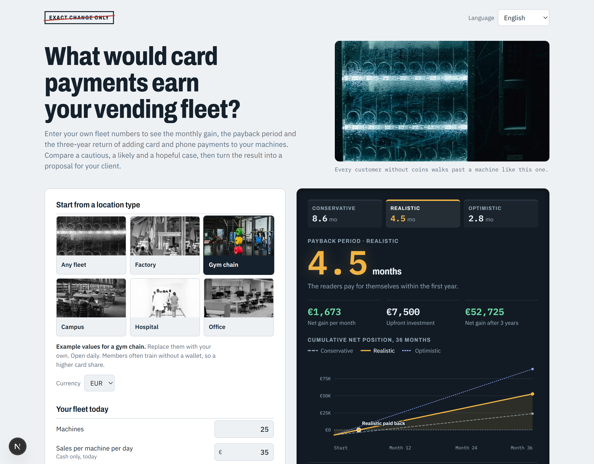

# Cashless Vending Payback

A calculator a vending sales team can open in front of an operator and use to answer the one question that decides the deal: **when do the card readers pay for themselves?**

**Live demo:** [vending-payback.vercel.app](https://vending-payback.vercel.app)



## Why it exists

Card readers for vending machines are usually sold on features: contactless, mobile wallets, telemetry. Operators buy on numbers. They want to know what the readers cost, what they bring back and how long that takes, using their own fleet rather than a brochure average.

This tool is built around that conversation:

- **The operator's own numbers.** Every figure is editable. The location types (factory, gym chain, campus, hospital, office) are starting points, labelled as example values, and nothing in the tool is presented as market data.
- **Honest gain.** Only the margin on extra sales counts as gain, never the extra revenue. Processing fees are charged on the card share of the new, higher sales. A business case that overstates the gain falls apart at the operator's finance team.
- **Three cases, not one.** Nobody knows the sales uplift before a pilot. Showing a conservative, a realistic and an optimistic case side by side moves the discussion from "do I believe your number?" to "which case looks like my site?".
- **A document the buyer can forward.** One click turns the figures into a printable proposal with the client's name and logo, every assumption listed, estimates marked as estimates and example values marked as examples. It ends with the natural next step: a pilot that replaces the estimates with measured figures.

## What it does

| | |
|---|---|
| Scenario comparison | Conservative / realistic / optimistic, each with its own sales increase and card share; one shared 36-month chart |
| Location presets | Factory, gym chain, campus, hospital, office; fills the worksheet with labelled example values |
| Client proposal | Client name, optional logo (stays in the browser), all three cases, assumptions and method; prints to A4 or saves as PDF |
| Shareable state | The address bar holds every input, so a worked-out case can be bookmarked or sent |
| Pilot data | Upload a CSV (date, machine, sales, payment type) from machines that already have readers. The card share and the sales increase are measured, the realistic case uses them, and they are marked "measured" in the proposal. The file is read in the browser and never uploaded. An example file with invented data is included |
| Saved client cases | Save, list, open and delete named cases in the browser (localStorage), with Undo on delete |
| Email summary | Copies a plain-text business case for a client email |
| Languages | English, Turkish and Dutch. The language is picked from the visitor's country (Vercel's IP country header), then the browser, and can be changed by hand. A proposal can be printed in a different language from the interface |
| Currencies | EUR, USD, GBP and TRY, formatted the local way. Example values convert to a believable size in lira; figures you typed stay as typed |

## How the numbers are worked out

From pilot data:

```
card share     = card and phone sales ÷ all sales, from the install date on
sales increase = average sales per machine per day after the install
                 ÷ the same before it − 1, on machines with data on both sides
```

The install date defaults to the first day with a card or phone sale and can be changed. A before-and-after comparison also picks up seasonal effects, so a longer pilot gives a steadier figure.

Business case:

```
monthly sales today   = machines × sales per machine per day × selling days
extra gross profit    = monthly sales today × sales increase × gross margin
processing fees       = monthly sales today × (1 + sales increase) × card share × fee
service fees          = machines × service fee per reader
cash handling saved   = machines × saving per machine
net gain per month    = extra gross profit + cash handling saved − processing fees − service fees
upfront investment    = machines × reader price
payback period        = upfront investment ÷ net gain per month   ("Never" when the net gain is not positive)
net gain after 3 years = net gain per month × 36 − upfront investment
```

Reference case, covered by a unit test: 50 machines, €40 a day, 30 days, 40 % margin, 15 % uplift, 50 % card share, €10 cash handling saved, €300 reader, €8 service fee, 2.5 % processing fee → **€2,837.50 a month, payback in 5.29 months, €87,150 after three years.**

## Built with

Next.js (App Router), React, TypeScript and Tailwind CSS. The calculation lives in pure functions in `src/lib/` with Vitest tests; the interface is in `src/components/`. The first version, a single HTML page, is kept in `legacy/v1.html`.

```bash
npm install
npm run dev     # http://localhost:3000
npm test
```

## Photos

From [Unsplash](https://unsplash.com), free under the Unsplash License, cropped so no product or brand is visible: [vending machine](https://unsplash.com/photos/dq7FTxwVeeE), [factory](https://unsplash.com/photos/hDXuYYMtQgY), [gym](https://unsplash.com/photos/2e4lbLTqPIo), [campus](https://unsplash.com/photos/Ma7aOy5mMp0), [hospital](https://unsplash.com/photos/Pd4lRfKo16U), [office](https://unsplash.com/photos/pYlBAu3de0w).

---

Built by Canberk Yıldız, international B2B sales.
